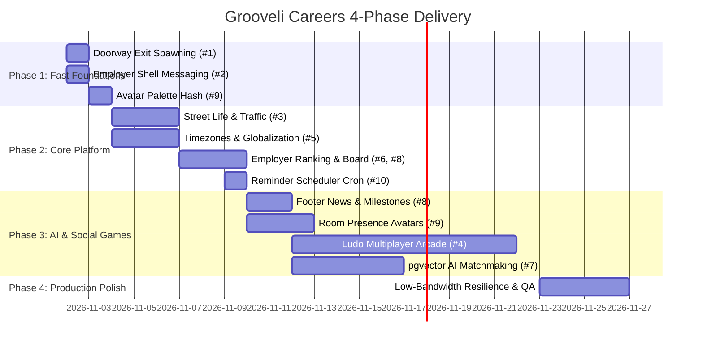

# Grooveli Careers — Product & Engineering Implementation Plan

**Target Architecture:** Production-Ready ("Lagos Hustle to Global Scale")  
**Target Timeline:** 4-Phase Iterative Delivery (~3.5 Calendar Weeks)  
**Status:** Ready for Execution  

---

## 1. Overview & Objectives

This implementation plan transitions Grooveli Careers from a frontend prototype into a high-performance, production-ready career platform experienced through an interactive virtual world.

### Key Goals
1. **Lively & Resilient World ("Lagos & NYC Hustle"):** Deliver street life, realistic traffic (Danfos, cabs, scooters), ambient city audio, and interactive kiosks while remaining strictly within mobile 60fps frame budgets.
2. **Seamless Navigation & Messaging:** Fix office exits to spawn outside districts; equip employers with an inbox, notification bell, and candidate outreach channels with anti-spam safeguards.
3. **Smart Matchmaking & Profile Scanning:** Automated CV/profile parsing, skill gap diagnostics, `pgvector` semantic matching, interview simulations, and proactive career nudges.
4. **Global Platform with Local Soul:** Dynamic multi-currency support (`NGN`, `USD`, `GBP`, `EUR`), global city seeds, and IANA timezone-aware quiet hours.
5. **Fair Dual-Sided Leaderboard:** Rank job seekers on verified skill badges and employers on a transparent **Hiring Responsiveness Score (HRS)**.
6. **Social Waiting Room:** Deliver a turn-based multiplayer **Ludo Arcade** for organic networking while candidates await interviews, with a clear path to Speed Chess.

---

## 2. Feature & Architecture Breakdown

### Item 1: Office Exit Doorway Spawning (Track A — City)
* **Goal:** Exiting an office, apartment, or company HQ returns the player to the front of that specific district doorway, rather than resetting to the central plaza.
* **Mechanism:**
  - Add an `arriveAt: { districtId: string, spawnKey: string } | null` property to `usePlayerStore`.
  - When triggering an exit interaction from an interior, set `arriveAt` before triggering route navigation.
  - In `CityScene.create()`, check `playerStore.arriveAt`. If present, resolve the district coordinates from `locations.js`, spawn the player 48px below the doorway facing south, pan the camera smoothly, and clear the slot.

### Item 2: Employer Messaging & Candidate Discovery (Track C — Product)
* **Goal:** Enable employers to discover talent, initiate conversations, and manage inbound replies directly from the dashboard.
* **Mechanism:**
  - Add `NotificationBell` and `InboxTrigger` to `EmployerShell.jsx`, unifying the notification surface across candidate and employer modes.
  - Add a **"Message Candidate"** action on each candidate card in `/employer/candidates`. Clicking opens a conversation modal pre-tagged with `origin: 'candidate_discovery'`.
  - **Spam Guardrail:** Employers are limited to **one unreplied invite message**. The conversation remains in a pending state until the candidate accepts or replies.
  - Dispatches immediate in-app notification rows and queues an email alert.

### Item 3: Street Life & Urban Hustle (Track A — City)
* **Goal:** Introduce dynamic city energy (pedestrians, commercial Danfo buses, tech cabs, delivery scooters) without impacting network bandwidth or frame budgets.
* **Mechanism:**
  - **Scenery Pool (Client-Side, Non-Networked):**
    - Cap at 20 sidewalk pedestrians with randomized speeds and 8 roadway vehicles moving along predefined spline paths.
    - Deceleration zones: vehicles stop when pedestrians cross designated zebra crossings.
  - **Interactive Kiosks:** Street vendors (coffee cart, newspaper kiosk, tech meetup board) with `[E]` key interaction for local news and hiring announcements.
  - **Soundscape:** Subtle positional ambient city hum with a toggle on the HUD.
  - **Visual Distinction:** Real connected players display floating nameplates and Level badges (`[Lvl 3] Alex`); ambient pedestrians display no nameplate.

### Item 4: Indoor Social Games (Track D — Games)
* **Goal:** Provide casual, social multiplayer games that act as waiting rooms where candidates and recruiters break the ice.
* **Phased Rollout:**
  - **Phase 1 (Immediate): Ludo Arcade (2–4 Players)**
    - Simple turn-based state machine using Supabase Realtime Channels.
    - Server-side move and dice validation to prevent cheating.
    - 45-second turn timers with automated bot takeover on disconnect.
    - Daily career XP reward cap (+15 XP per win, max 45 XP/day).
  - **Phase 2 (Follow-up): Casual Speed Chess**
    - Rules and board validation powered by `chess.js` and Stockfish WASM.
  - **Phase 3 (Post-Validation): 8-Ball Pool**
    - Deferred until multiplayer engagement metrics justify 2D physics networking.

### Item 5: Platform Globalization & Timezone Engine (Track B — Backend)
* **Goal:** Expand beyond localized references to support international candidates and employers seamlessly.
* **Mechanism:**
  - **Seed Data:** Expand location datasets across Lagos, London, New York, Nairobi, Toronto, Berlin, and Singapore.
  - **Multi-Currency:** Add explicit ISO 4217 currency codes (`NGN`, `USD`, `GBP`, `EUR`, `KES`, `CAD`) on all job records. Update `formatCompactMoney` to format dynamically based on the job's currency.
  - **IANA Timezone Engine:** Store user quiet hours with explicit timezone strings (e.g. `Africa/Lagos`, `Europe/London`). Edge functions convert quiet hours to UTC before dispatching alerts.

### Item 6: Dual-Sided Leaderboard & Employer Responsiveness (Track B + C)
* **Goal:** Provide transparent, motivating leaderboards for both job seekers and hiring companies.
* **Candidate Metric:** Total verified skill assessment XP + peer reputation + challenge completions.
* **Employer Metric (Hiring Responsiveness Score - HRS):**
  $$\text{HRS} = 40\% \times (\text{Response Speed}) + 30\% \times (\text{Feedback Rate}) + 30\% \times (\text{Candidate Experience Rating})$$
  - Discourages job board spam and rewards teams that communicate quickly. Top-tier companies receive a **"Verified Quick Responder"** badge on listings.
* **Privacy:** A global opt-out setting lets any user or company hide their account from public leaderboards.

### Item 7: AI Career Copilot — Profile Scanner & Smart Recommendation Engine (Track E — AI)
* **Goal:** Enable one-click automated profile and CV scanning that extracts verified skills, diagnoses competency gaps, and delivers high-precision opportunity recommendations across jobs, companies, and missions.
* **Mechanism:**
  1. **Profile & CV Ingestion Scanner:**
     - Supports PDF/DOCX resume upload or one-click scan of an existing Grooveli profile.
     - LLM-powered structured extraction maps work history, core technologies, frameworks, and project impact to Grooveli's standardized skill taxonomy.
     - Auto-populates candidate skills, experience items, and suggests assessments to verify claims.
  2. **Skill Gap Diagnostics & Actionable Pathways:**
     - Compares the scanned profile against market requirements for target roles (e.g. Senior Frontend Engineer).
     - Identifies high-leverage skill gaps:
       > *"Your profile matches 82% of Senior Frontend roles in the Tech Hub. Gaps identified: Docker & CI/CD Pipelines. Completing the Docker Assessment will push you to 94%."*
     - Recommends tailored in-world missions and learning paths to earn verified XP badges.
  3. **Multi-Factor Opportunity Recommendation Engine:**
     - Hybrid semantic search powered by PostgreSQL `pgvector`:
       $$\text{RecommendationScore} = 0.55 \times \text{CosineSimilarity}(\vec{Profile}, \vec{Job}) + 0.30 \times \text{SkillOverlap} + 0.15 \times \text{Salary/LocationFit}$$
     - Transparent match explanations: Displays match percentage alongside exact matching skills and missing prerequisites.
     - **Spatial World Routing:** Clicking a recommended role on the HUD guides the player's avatar directly to the hiring company's district building in Grooveli City.
  4. **Employer Applicant Screening Assistant:**
     - Allows hiring teams to scan candidate pools against custom job specs.
     - Generates instant candidate suitability summaries, highlights key strengths, flags discrepancies, and drafts tailored technical interview questions.
  5. **Unified AI Architecture (Single Provider — Google Gemini):**
     - **Provider Standardization:** Powered exclusively by Google Gemini via the official `@google/genai` SDK. Requires only one secret: `GEMINI_API_KEY`.
     - **Resume / CV Parsing:** Uses **Gemini 2.0 / 1.5 Flash** with native PDF document ingestion (no external OCR required; parses multi-column resumes directly into validated JSON schemas).
     - **Vector Search & Matchmaking:** Uses **Gemini `text-embedding-004`** (768 dimensions) to populate Supabase `pgvector` for instant sub-15ms semantic matching.
     - **Career Copilot & Mock Interviews:** Uses **Gemini Flash** streaming with Server-Sent Events (SSE) for low-latency interactive dialogue grounded in verified job data.
     - **Zero Client Exposure:** All Gemini calls are executed server-side via Supabase Edge Functions (`/api/ai/scan-profile`, `/api/ai/chat`, `/api/ai/recommendations`). No keys are exposed in the client.

### Item 8: Live Footer Ticker (Track B + C)
* **Goal:** Keep the community connected to platform activity and global industry trends.
* **Mechanism:**
  - **Platform Milestones (50%):** Live stream of public achievements (*"Amara K. passed React Architecture Assessment"*, *"Northwind Systems posted 2 new roles"*).
  - **Curated Career News (50%):** Scheduled server-side RSS aggregator fetching from tech and career feeds every 2 hours, cached in the database.

### Item 9: Room Presence & Consistent Avatars (Track A + B)
* **Goal:** Fill interior rooms with visible candidate avatars that look consistent across sessions.
* **Mechanism:**
  - Replace hardcoded color values with a deterministic 12-palette hash of the user ID:
    $$\text{PaletteIndex} = \text{hash}(userId) \pmod{12}$$
  - Interior scenes render presence figures at designated seating/desk coordinates.
  - 15-second presence heartbeat with 300ms alpha fade transitions to eliminate jarring pop-in/pop-out.

### Item 10: Mission Reminder Scheduler (Track B — Backend)
* **Goal:** Deliver reliable background reminders when users are away from the application.
* **Mechanism:**
  - Scheduled Supabase Edge Function running every 30 minutes via `pg_cron`.
  - Queries active missions expiring within 24 hours, unread interview requests, and application updates.
  - Filters out users currently in their local quiet hours (enforced via Item 5's timezone engine).
  - Batches notifications to in-app notification records and email digests.

### Item 11: In-World Plaza Leaderboard Totem (Track A + C)
* **Goal:** Give the leaderboard a physical presence in the virtual city.
* **Mechanism:**
  - Interactive physical totem located in the central plaza (`[E] VIEW LEADERBOARD`).
  - Pressing E opens the dual-tab leaderboard modal.
  - HUD displays a compact widget showing the player's current rank and the top-ranked candidate.

---

## 3. Four-Phase Execution Plan

### Phase 1: Fast Foundations & Unblockers (Days 1–2)
* **Sprint Focus:** Deliver zero-dependency quick wins that immediately improve UX.
* **Tasks:**
  - [ ] Implement `arriveAt` in `usePlayerStore` and wire district doorway returns (**Item 1**).
  - [ ] Add `NotificationBell` and `InboxTrigger` to `EmployerShell.jsx` (**Item 2**).
  - [ ] Add "Message Candidate" action on candidate cards with 1-invite guardrail (**Item 2**).
  - [ ] Implement server-side deterministic color palette hashing for user IDs (**Item 9**).

### Phase 2: City Hustle & Core Backend (Days 3–7)
* **Sprint Focus:** Bring the city to life and establish robust backend data contracts.
* **Tasks:**
  - [ ] Build client-side ambient pedestrian & Danfo/car spline pathways in `CityScene` (**Item 3**).
  - [ ] Add interactive street kiosks with localized micro-dialogue bubbles (**Item 3**).
  - [ ] Add multi-currency fields (`currency`) to job schemas and update money formatting (**Item 5**).
  - [ ] Add IANA timezone strings to user profiles and build quiet hours conversion engine (**Item 5**).
  - [ ] Build Employer Responsiveness Score (HRS) calculation and public endpoints (**Item 6**).
  - [ ] Implement scheduled Supabase Edge Function for mission reminder sweeps (**Item 10**).

### Phase 3: AI, Social Waiting Room & Live Pulse (Days 8–17)
* **Sprint Focus:** Intelligent matchmaking, automated profile scanning, and social multiplayer features.
* **Tasks:**
  - [ ] Implement PDF/DOCX CV parsing & profile ingestion pipeline (**Item 7**).
  - [ ] Set up `pgvector` embeddings table for candidate profiles, skill tests, and job postings (**Item 7**).
  - [ ] Build automated Skill Gap Diagnostics engine and personalized recommendation endpoints (**Item 7**).
  - [ ] Wire streaming AI Career Companion endpoint with proactive nudges and mock interviews (**Item 7**).
  - [ ] Build live footer ticker component with alternating milestone events and RSS news (**Item 8**).
  - [ ] Render interior room presence avatars with fade transitions on 15s heartbeats (**Item 9**).
  - [ ] Implement plaza leaderboard totem with interactive dual-tab rankings (**Item 11**).
  - [ ] Build **Ludo Arcade** MVP in `src/games/ludo/` using Supabase Realtime Channels (**Item 4**).

### Phase 4: Production Hardening & "Lagos Life" Resilience (Days 18–21)
* **Sprint Focus:** Resilience under spotty networks, mobile optimization, and security audits.
* **Tasks:**
  - [ ] Implement IndexedDB client caching for city tilesets, sprites, and audio sprites.
  - [ ] Implement `navigator.connection.saveData` listener to auto-throttle background animations and presence polling on low-data connections.
  - [ ] Conduct end-to-end load testing on Realtime presence channels and edge function rate limits.

---

## 4. Track Ownership & Work Allocation

| Track | Primary Domain | Focus Items | Required Skillsets |
|---|---|---|---|
| **Track A — City** | Phaser Scenes, World Data, Sprites | #1 (Exit Flow), #3 (Street Life), #9 (Room Avatars) | Phaser 3, Canvas Rendering, Game Loops |
| **Track B — Backend** | Supabase Migrations, Edge Functions, Cron | #5 (Timezones), #6 (HRS Leaderboard), #8 (News RSS), #10 (Reminders) | PostgreSQL, Supabase, Deno, Cron |
| **Track C — Product** | React Components, Shells, HUD | #2 (Employer Messaging), #6/#11 (Leaderboards), #8 (Footer Ticker) | React 19, Zustand, Tailwind/CSS |
| **Track D — Games** | Arcade & Social Multiplayer | #4 (Ludo Multiplayer Arcade) | Realtime WebSockets, State Machines |
| **Track E — AI & Data** | Embeddings, Semantic Search, LLMs | #7 (Profile Scanner, Skill Gap Diagnostics & Career Copilot) | pgvector, Google Gemini SDK (@google/genai) |

---

## 5. Verification & Acceptance Criteria

1. **Office Transitions:** Entering an office from Technology Hub and exiting returns the player within 48px of the Technology Hub doorway facing down, without touching the plaza.
2. **Employer Outreach:** An employer can send an invite to an uncontacted candidate. A second attempt is disabled until the candidate responds. The message shows in the employer's inbox.
3. **Urban Performance:** `CityScene` maintains a steady 60 FPS on mid-tier mobile devices with 20 walking pedestrians and 8 moving vehicles. Real players show nameplates; scenery NPCs do not.
4. **Timezone Accuracy:** A user in London (`Europe/London`) with quiet hours 22:00–07:00 receives no reminder notifications during their local night, regardless of server UTC time.
5. **Fair Leaderboard:** Employer rankings reflect actual response times and candidate feedback. Opting out immediately removes the company from public views.
6. **Profile Scan & Matchmaking:** Uploading a PDF resume or scanning an existing profile automatically extracts verified skills into the profile within 3 seconds, displays a prioritized list of open jobs with percentage match scores, and pinpoints exact missing skills with recommended assessments.
7. **Spatial Opportunity Routing:** Clicking a recommended opportunity on the HUD places a navigation waypoint on the city map directing the candidate to that employer's district building.
8. **Multiplayer Ludo:** Two players can join a game room, roll dice with server validation, and complete a match. Disconnections trigger bot takeovers within 45 seconds without freezing the room.
